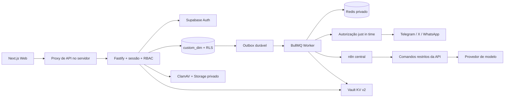

# Arquitetura e decisões de implementação

Base: PRD v1.0, plano de Sprints e `prd/dim-dev-doc.md`, lidos em 24/10/2026.

## Responsabilidade de produto — decisão de 25/10/2026

O Audience Builder gere persona, trajetória de autoridade e gestão editorial do blog. O DIM executa ações aprovadas nos nove itens do escopo e devolve evidências/resultados/métricas. A origem canônica da persona continua rastreada ao Authority Engine conforme o contrato existente do Audience. Flux e Control Tower mantêm orquestração e provisionamento transversais. Contrato e estado real: [audience-integration.md](audience-integration.md).

O consumidor DIM já vincula/sincroniza contexto aprovado e protege a persona gerida pela origem. A API persistida de export, a ingestão transversal de ações e o retorno ao Audience ainda não estão concluídos. Nenhum endpoint demonstrativo foi tratado como integração operacional.

## Compatibilidade de infraestrutura

O dev-doc confirma `vps2`, projeto Easypanel `sistemas`, serviço `dim`, domínio `dim.fbr.news`, Supabase central `https://supabase-control-tower-api.fbr.news`, project ID `3a4d3421-7d76-421c-afe2-e981e12ef64b`. Não fornece acesso à VPS, rede, volumes, versões, SMTP, credenciais ou n8n URL. Nenhum serviço remoto foi alterado.

O dev-doc descreve um template genérico com sete tabelas; o PRD e o SQL revisado especificam 79 tabelas de domínio. A implementação preserva essas 79 e acrescenta quatro de integração Audience (83 no total, mais histórico técnico de migrations); mantém `custom_dim` e acrescenta `project_id`/`owner_id` à organização. Não transforma `entities/records` em uma segunda fonte. O path `/09-codigo` citado pelo dev-doc diverge da raiz do monorepo: o build deve usar a raiz e essa adaptação exige validação no catálogo/Easypanel antes do deploy.

## Fluxo

## Isolamento e autorização

O header `X-Organization-Id` é somente um seletor. A API valida a sessão no GoTrue, expiração, existência de `session_id` em `auth.sessions`, organização ativa, membership atual e permissões/grants persistidos. Nunca usa `user_metadata` para conceder acesso. Administradores e acessos a segurança requerem `aal2`.

Cada comando revalida membership, abre uma transação, define contexto local de organização/usuário e assume `dim_app` sem `BYPASSRLS`. O navegador não recebe grants de acesso ao schema. A conexão de controle permanece no backend para validação de Auth, gerenciamento de acesso e operações de serviço; não deve ser distribuída para n8n/agentes. FKs compostas e os triggers do baseline negam referências cruzadas. Escopos são filtrados no SQL antes de paginação. Roles e políticas não podem ser alteradas por `dim_app`.

A connection string de controle ainda tem privilégios elevados. Separar fisicamente as credenciais de controle/worker/runtime e adicionar sessões de serviço dedicadas é endurecimento recomendado antes da aprovação de produção, com teste na versão instalada. Não se declara isolamento absoluto de um backend comprometido.

## Versões, consentimento e publicação

Personas, versões de conteúdo, decisões, auditoria, consentimentos, métricas e eventos financeiros são protegidos contra UPDATE/DELETE. Alterar consentimento cria uma revogação que referencia o original. Restaurar uma persona significa criar outra versão. Conteúdo alterado cancela os jobs anteriores e passa por nova revisão.

Aprovação exige outro revisor e guarda ID da versão, hash e versão da política. O worker confere novamente os direitos, escopo por canal, disclosure no texto, membership, integração, token, capacidades, frescor e aprovação vigente. Uma identidade é bloqueada sem contrato/consentimentos (humana), persona/disclosure (virtual), ou ambos (híbrida).

O efeito externo e a gravação SQL não formam uma transação distribuída. Para APIs sem idempotência, timeout, falha de persistência após envio ou morte de worker produzem estado `uncertain`. Esse estado nunca é reenviado automaticamente. Reconciliação exige evidência privada, MFA e auditoria. Retries automáticos são reservados a falhas classificadas como seguras, como HTTP 429.

## Automações

Agentes não recebem ferramentas administrativas, credenciais sociais nem acesso ao cofre. O adaptador Responses usa `store: false`, somente contexto de persona/brief/fontes, limite de saída e reserva conservadora de orçamento por assignment. Preços e modelo são configurados pela organização; não há preço/modelo presumido. Uso e custo são conciliados por `agent_runs` e `cost_events`. Falha após chamada externa preserva reserva para reconciliação.

Doze workflows n8n são importáveis e estão desativados. `content.generate` e `content.verify` executam comandos restritos da API. Os outros dez retornam uma necessidade explícita de configuração/ação humana. O transporte de publicação, inbox e consentimento é implementado no worker e não depende de um workflow fictício de sucesso.

## Fontes técnicas consultadas

- [Supabase RLS](https://supabase.com/docs/guides/database/postgres/row-level-security)
- [Supabase Storage upload](https://supabase.com/docs/reference/javascript/storage-from-upload)
- [Supabase MFA](https://supabase.com/docs/reference/javascript/auth-mfa-challengeandverify)
- [X OAuth 2.0 com PKCE](https://docs.x.com/fundamentals/authentication/oauth-2-0/authorization-code)
- [Telegram Bot API](https://core.telegram.org/bots/api)
- [BullMQ retries](https://docs.bullmq.io/guide/retrying-failing-jobs)
- [OpenAI geração de texto / Responses](https://developers.openai.com/api/docs/guides/text)

O índice `supabase.com/changelog.md` não pôde ser processado pela ferramenta web (content-type markdown); os guias relevantes foram consultados. A página Meta de webhooks não ficou acessível pela ferramenta; o adaptador WhatsApp permanece sujeito a homologação da versão Graph configurada e das permissões reais. As convenções Next.js foram conferidas na documentação empacotada da versão 16.4.3.
