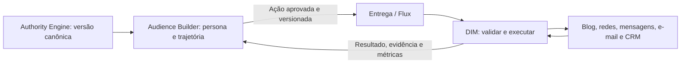

# Audience Builder → DIM: direção, execução e retorno

Decisão confirmada pelo usuário em 25/10/2026. Projeto de origem: `F:\Projetos\_FBR\FBR Audience`.

O **Audience Builder** é a porta de criação e gestão da persona e da trajetória de construção de autoridade, incluindo o blog e sua gestão editorial. O **DIM é o executor das ações aprovadas**, dentro do escopo de Blogs, Instagram, Facebook, X, WhatsApp, Telegram, E-mail, YouTube e CRM. A lista completa permanece no escopo; recomendações e cadência do Audience não significam criação automática de contas.

## Responsabilidades

| Responsabilidade | Dono |
| --- | --- |
| Criação/gestão da persona, versão aprovada e identidade editorial | Audience Builder, preservando a origem canônica no Authority Engine conforme seu contrato atual |
| Tese, posicionamento, público, pilares, objetivos e marcos de autoridade | Audience Builder |
| Estratégia, configuração e gestão editorial do blog | Audience Builder |
| Execução das ações aprovadas: preparação operacional, agendamento, publicação, mensagens e coleta nos canais habilitados | DIM, pelos adaptadores oficiais implementados e autorizados |
| Contas, escopos, titularidade, direitos, consentimentos e capacidade efetiva | DIM valida antes da execução |
| Orquestração transversal durável e provisionamento técnico | Flux/Control Tower conforme os contratos existentes; não são duplicados no DIM |
| Resultado de execução, erro, ID externo, evidência, custo e métricas | DIM registra e deve devolver ao Audience pelo contrato de retorno |

Esse diagrama representa o contrato alvo. O ciclo completo ainda não está operacional.

## O que existe na origem e o que foi implementado no DIM

Foram examinados no Audience os contratos `persona-intake.ts`, `audience-project.ts`, `manifesto.ts`, o adapter Authority e as rotas `api/v1/projects`, `api/v1/persona/intake` e `api/v1/manifest`.

O Audience atual recebe uma `PersonaIntakePackage` aprovada pelo Authority Engine. A rota GET de projetos contém um registro demonstrativo fixo; o POST de intake valida e retorna metadados, sem fornecer um read model persistido de contexto para o DIM. Essas respostas não foram usadas como prova de integração real. Não foi inventado um endpoint de exportação.

No DIM foi implementado e testado localmente:

- Vínculo por organização/influenciador com `tenant_id`, `project_id` e `persona_id` externos. Criar o vínculo exige administração/MFA e governança. Trocar a origem de um vínculo existente é rejeitado e exige migração revisada.
- Novas identidades criadas pela API usam `persona_source=audience_builder`. Registros anteriores permanecem explicitamente `legacy_local`, preservando histórico. Ao vincular uma identidade legada, sua fonte passa a ser o Audience.
- Persona e perfil estratégico geridos pelo Audience não podem ser recriados/editados pelo DIM. A interface apresenta o vínculo, a sincronização, a persona recebida, os objetivos, os marcos e os blogs como dados de origem.
- Consulta HTTP autenticada, somente ao endereço oficial configurado no cofre, com tenant/projetos autorizados, timeout, limite de resposta e redirects desabilitados. Ausência de configuração falha fechada.
- Validação do pacote já existente `audience-builder.persona-intake.v1`: aprovação cobre a versão, hash SHA-256 canônico, persona/projeto/tenant exatos, sem credenciais e sem pacote `testOnly`. A fixture DIM foi conferida com o validador real do checkout Audience por `scripts/verify-audience-contract.ts`.
- Histórico imutável de contextos, importação idempotente e rejeição de regressão ou divergência de versão/hash. A cópia operacional da persona preserva IDs/hash da origem e não constitui uma segunda autoria.
- Falha na confirmação ou contexto com mais de 24 horas bloqueia seu uso para ativação, aprovação/publicação e geração por agente. A sincronização atual é manual/autenticada; não existe alegação de atualização contínua remota.
- Mudança de contexto cancela jobs de publicação ainda pendentes e exige uma nova versão/revisão de conteúdo. Cada versão de conteúdo registra o contexto que efetivamente utilizou, incluído no hash. Uma falha não apaga a última versão conhecida nem autoriza publicação com ela.

As duas novas tabelas, `audience_bindings` e `audience_context_versions`, usam RLS e referências de tenant/identidade. O schema passa a ter 79 tabelas originais e duas de integração; a quinta migration é aditiva. Nenhuma migration remota foi executada.

## API DIM disponível

| Método | Rota | Efeito |
| --- | --- | --- |
| POST | `/api/v1/influencers/:id/audience/bind` | Vincula tenant/projeto/persona; não cria persona nem conta |
| GET | `/api/v1/influencers/:id/audience` | Estado e metadados do vínculo, sem snapshot |
| GET | `/api/v1/influencers/:id/audience/context` | Contexto recebido; exige leitura de governança |
| POST | `/api/v1/influencers/:id/audience/sync` | Lê e confirma o contexto aprovado na origem; body `{}` |

Contrato do consumidor: `packages/contracts/src/audience.ts`; JSON Schema exportável: `docs/contracts/audience-context-v1.schema.json`.

O envelope **novo** `dim.audience-context.v1` contém `contractId`, `contractVersion`, `source`, `tenantId`, `projectId`, `contextVersion`, `contextHash`, o `personaPackage` original, `authority` e `blogs`. Ele ainda precisa ser disponibilizado pela API persistida do Audience.

`personaPackage.contentHash` cobre seu `snapshot`, usando o algoritmo canônico existente na origem. `contextHash` cobre o envelope completo exceto o próprio `contextHash`, com chaves de objeto ordenadas e ordem de arrays preservada. Hash garante integridade do conteúdo; a autenticação da origem é uma obrigação separada do transporte.

## Configuração do consumidor

A API DIM usa seu Vault existente. Em `dim/<organization_id>/audience-builder`, configurar os campos abaixo somente quando o endpoint real existir e seu escopo estiver autorizado:

| Campo | Conteúdo |
| --- | --- |
| `read_model_url` | URL HTTPS oficial completa, sem path presumido |
| `token` | Credencial de leitura restrita resolvida no servidor |
| `tenant_id` | Tenant Audience autorizado para essa organização DIM |
| `allowed_project_ids` | Array JSON explícito com projetos autorizados |

O cliente acrescenta `tenant_id`, `project_id` e `persona_id` à query. O token vai apenas no header Authorization. O navegador, os agentes e o conteúdo recebido não configuram URLs nem recebem credenciais. HTTP só é permitido para loopback no modo de desenvolvimento explicitamente configurado.

Não se lê o banco interno do Audience e não se escreve diretamente em seus projetos/blogs. O blog recebido como `draft` ou `provisioning`, mesmo com URL, não é considerado publicável. Receber um plano `configured` não comprova conta criada ou permissão de publicação.

## Contrato de execução a implementar

O próximo incremento precisa de um pedido persistido e aprovado vindo do Audience, contendo no mínimo:

1. Versão de contrato, `event_id`, `action_id`, chave idempotente, correlação e causalidade.
2. Tenant/projeto/persona, versão da persona e versão/hash do contexto.
3. Ação e canal concretos, recurso/conta de destino, versão e hash do conteúdo ou referência oficial resolvível.
4. Aprovação exata: identificador, ator, data, escopo, versões cobertas e validade.
5. Janela de execução e evidências de pré-condições.

O DIM deve conferir o pedido, resolver a conta dentro do vínculo autorizado, aplicar suas guardas operacionais e só executar com o adaptador efetivamente disponível. Aprovação da origem não ignora direitos, opt-in, capacidade, políticas, RBAC nem a aprovação local exigida pela organização.

O retorno deve identificar `action_id`, `event_id`, contexto, resultado (`blocked`, `awaiting_review`, `queued`, `running`, `completed`, `failed` ou `uncertain`), motivo, ID/URL externa quando existentes, evidência, custo, timestamps e métricas com origem/frescor. Repetição retorna o mesmo receipt; resultado externo incerto não é reenviado automaticamente.

**Ainda não implementados:** export persistido na origem, ingestão remota de ações aprovadas, dispatch transversal completo, callback/receipt de retorno ao Audience e homologação ponta a ponta. Os conectores sociais/CMS/e-mail ausentes continuam ausentes; este vínculo não os substitui.

Para blogs, a gestão editorial permanece no Audience; o DIM deverá executar as ações aprovadas usando a API/adapter oficial do runtime de blogs. Os paths de publicar/editar/provisionar ainda precisam de contrato real. Não existe um CMS paralelo criado pelo DIM nesta entrega.
