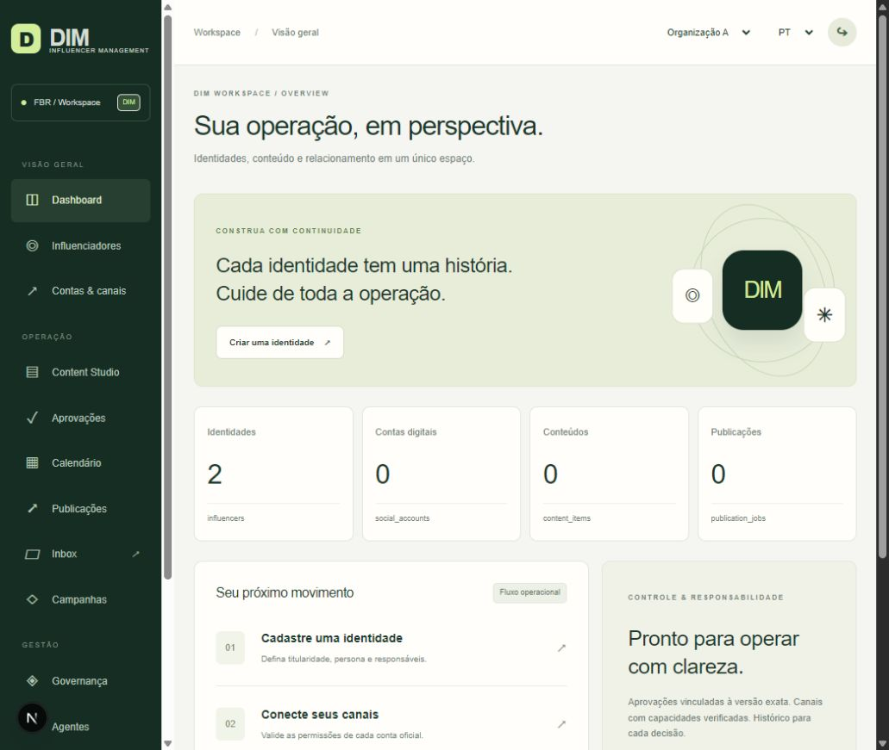

# QA da interface e checklist Sitebasics

24/10/2026. Cobertura: aplicação privada DIM, rotas compartilhadas, login, dashboard autenticado, diretório, criação e retomada de identidade. Browser em loopback com Auth/API de teste e PostgreSQL descartável; nenhuma conta externa ou publicação real.

## Evidências funcionais

1. Página de login renderizada com campos rotulados, senha oculta e MFA.
2. Login via serviço de teste abriu dashboard com KPIs reais da fixture e seletor de duas organizações.
3. Wizard criou `Luna QA local`, tipo virtual, com responsável autenticado, idioma e fuso.
4. Diretório exibiu o registro persistido após navegar para outra rota.
5. Ficha exibiu guardas de direitos e ativação, sem permitir uma identidade sem persona/disclosure se tornar ativa.
6. Retomada pelo link da ficha abriu a sessão de onboarding existente.
7. Edição `{"qa":"preservar ao trocar etapa"}` seguida de avanço imediato e retorno preservou o valor. A troca de etapa agora faz flush antes de navegar.

As screenshots usam somente exemplos locais. O ambiente descartável é encerrado ao final; não é uma implantação do DIM. A fixture está isolada em `tests/browser-fixture.ts`, exige flag explícita e não é importada pelos entrypoints de produção.

## Checklist

| Página ou escopo | Requisito | Estado | Evidência ou ação necessária |
| --- | --- | --- | --- |
| Site inteiro | 404 personalizada | OK | `app/not-found.tsx`, roteamento de prefixos desconhecidos com `notFound()`; conferir HTTP em produção |
| Site inteiro | robots.txt | OK | Metadata route bloqueia indexação do aplicativo administrativo privado |
| Rotas | Títulos específicos | OK | Metadata por rota; login/dashboard têm título DIM; nomes amigáveis adicionais podem ser refinados |
| Rotas protegidas | Meta description por página indexável | Não se aplica | Aplicação privada com noindex, sem páginas de aquisição indexáveis |
| `/privacy` | Política de privacidade | Pendente | Comportamento técnico descrito; faltam controlador, contato, política e validação institucional |
| `/terms` | Termos de uso | Pendente | Restrições operacionais descritas; validar termos institucionais antes de lançamento |
| `/about` | Sobre | OK | Explica finalidade conforme o PRD, sem pessoas ou métricas inventadas |
| Site inteiro | Contato | Pendente | Canal oficial do responsável não fornecido |
| Navegação | Links internos | OK | Sidebar, módulos complementares, retorno e rodapé; prefixos registrados no router |
| Navegação | Breadcrumbs | OK | Workspace/domínio visíveis; refinamento de nomes e níveis profundos ainda necessário |
| Login/MFA | Alt text | OK | QR code do MFA possui descrição; elementos gráficos do dashboard são decorativos/aria-hidden |
| Site inteiro | Google Analytics | Pendente | Nenhum identificador fornecido; não foi ativado rastreamento externo |
| Aplicação privada | CTA de aquisição acima da dobra | Não se aplica | Não é página de venda; dashboard possui ação de criar identidade e formulários possuem salvar/voltar |
| Aplicação privada | CTA fixo mobile de conversão | Não se aplica | Fluxos administrativos, sem conversão de aquisição |
| Formulários | Confirmação / obrigado | OK | Criação navega para registro ou sessão persistida; erros preservam os campos |
| Contato | Prazo de resposta | Pendente | Depende de canal e SLA institucional confirmado |
| Rotas protegidas | Open Graph | Não se aplica | URLs privadas com noindex e sem objetivo de compartilhamento público |
| Site inteiro | Favicon | OK | `app/icon.svg`, identidade DIM própria |
| Aplicação privada | Cinco FAQs | Não se aplica | Escopo de operação interna; ajuda operacional está no runbook |
| Institucional | Cases, avaliações, foto real de equipe | Não se aplica | Não existem páginas de aquisição/cases/equipe no PRD; nenhum conteúdo dessa natureza foi inventado |
| Negócio local | Mapa / como chegar / schema local | Não se aplica | PRD não descreve atendimento presencial; sistema administrativo digital |
| Desktop | Layout e fluxo autenticado | OK | Inspeção visual em navegador, formulário, diretório e ficha com dados de teste |
| Mobile | Responsividade | Não verificado | Breakpoints, menu móvel, grids e tabelas adaptados no CSS; viewport móvel não disponível na ferramenta de QA |
| Segurança UI | Dados recebidos / XSS | OK | React escapa mensagens/conteúdo; nenhum uso de dangerouslySetInnerHTML; MIME ativo HTML/SVG não aceito |
| Segurança UI | Troca de organização | OK | Limpa dados e seleção antes do novo fetch; escopo definitivo na API/RLS |
| Acessibilidade | WCAG 2.2 AA completo | Não verificado | Labels, foco visível, estados/alerts e semântica implementados; faltam auditoria completa e leitores de tela |

Correções durante QA: referências amigáveis em formulários, responsável padrão vindo da sessão, navegação por rota com estado isolado, limpeza de dados ao trocar organização e flush do autosave. Pendências de conteúdo/ambiente permanecem explícitas e não impedem continuar os testes locais independentes.
